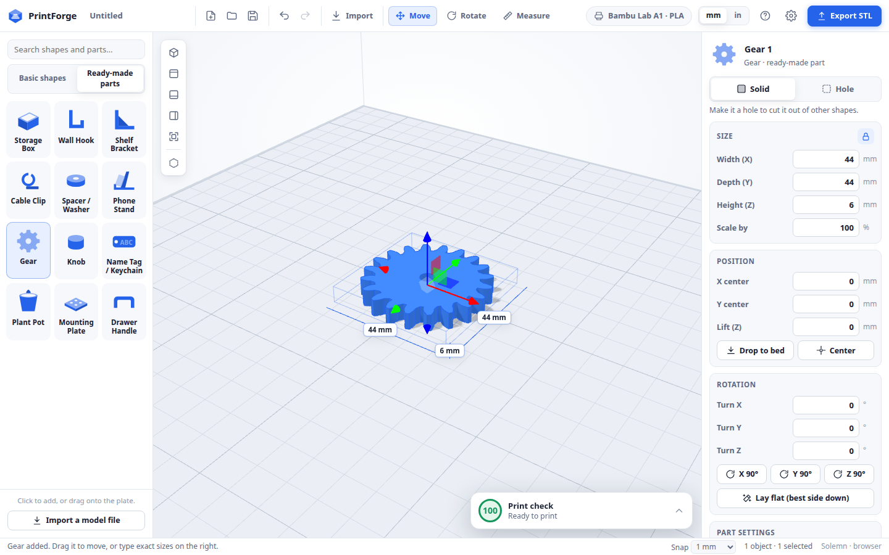
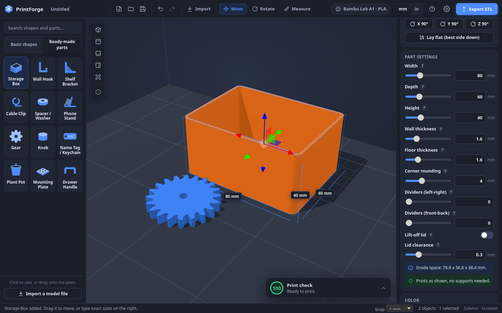
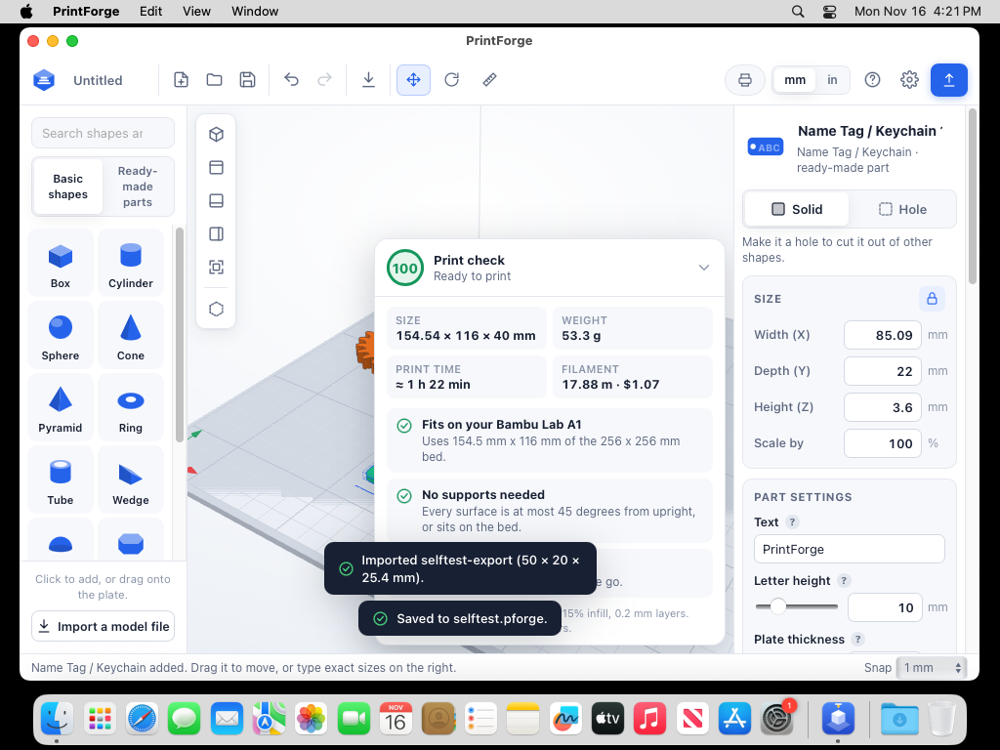

# PrintForge

**Easy 3D design for 3D printing — built with [Solemn](https://github.com/AlexVanchov/solemn).**

PrintForge is a desktop app for people who own a 3D printer but have never
done 3D design. Pick a shape or a ready-made part, type the exact size you
want ("50", "2.5 cm", "1 1/2 in"), cut holes, combine parts, and export an STL
for your slicer. While you work, a built-in **Print check** tells you, in
plain words, whether it will print — and fixes problems with one click.



## What you can do

- **25 shapes and ready-made parts.** Basic shapes (box, cylinder, sphere,
  cone, pyramid, ring, tube, wedge, dome, polygon, star, heart, 3D text) and
  functional parts that are designed to print without supports: storage box
  with dividers and lid, wall hook, shelf bracket, cable clip, spacer/washer,
  phone stand, involute spur gear, knob (round or D-shaft), name tag /
  keychain, plant pot with drainage and saucer, mounting plate, drawer handle.
  Screw holes get the right clearance automatically; horizontal holes are
  printable teardrops.
- **Exact sizes, the way you think.** Type sizes in the panel or click a size
  label in the 3D view. Units: mm, cm, inches, feet, fractions and sums
  (`3/4"`, `1 1/2 in`, `1in + 5mm`). Proportions lock on/off. Resizing a
  ready-made part changes its parameters, so **wall thicknesses stay exact**.
- **Holes and groups** — any shape can be a hole that cuts whatever it
  touches; group shapes into one part. Booleans are exact and always produce
  watertight, printable meshes (Manifold geometry kernel).
- **Measure, align, mirror, duplicate, rotate in place, drop to bed, lay
  flat (best side down), scale the whole model to an exact size or to fit the
  bed.**
- **Print check** for your printer (19 profiles: Bambu Lab, Prusa, Creality,
  Elegoo, Anycubic, Sovol, generic) and filament (PLA, PETG, ABS, ASA, TPU,
  Nylon, PLA-CF): fits on the bed, sits on the bed, supports needed, better
  orientation, bed adhesion, thin details, broken meshes — plus weight, cost,
  filament length and print-time estimates and a 0–100 score.
- **Import** STL (binary/ASCII), OBJ and 3MF — from the file browser or by
  dropping files on the window. Models drawn in inches or metres are detected
  and converted.
- **Export** STL or OBJ and open it in your slicer (Bambu Studio, OrcaSlicer,
  PrusaSlicer, Cura) in one click.
- Projects (`.pforge`), undo/redo, copy/paste, keyboard shortcuts, autosave
  and crash recovery, light and dark mode, first-run welcome and tour.

## Download

**[⬇ Get the latest release](https://github.com/AlexVanchov/printforge/releases/latest)**

- **macOS 12+** (Apple Silicon and Intel): download the `.dmg`, open it and
  drag **PrintForge** to Applications. The first time, macOS asks you to
  confirm because the app is not from the App Store: on macOS 15+ open
  *System Settings → Privacy & Security* and click **Open Anyway**; on older
  versions right-click the app → **Open** → **Open**.
- **Linux** x86_64: download the `.tar.gz`, install WebKitGTK
  (`sudo apt install libwebkit2gtk-4.1-0`), unpack and run `./printforge`.

## Build it yourself

macOS (needs Xcode Command Line Tools, Rust and Node.js 20+):

```sh
npm ci
scripts/build-macos.sh          # -> dist/PrintForge.app, .zip, .dmg
scripts/selftest-macos.sh       # launches the app, runs its self-test
```

Linux (needs `libwebkit2gtk-4.1-dev`, Rust, Node.js):

```sh
git clone https://github.com/AlexVanchov/solemn ../solemn && (cd ../solemn && cargo build --release)
npm ci
node tools/build.mjs --solemn ../solemn/target/release/solemn   # -> build/printforge
build/printforge                 # desktop window
build/printforge --serve 8765    # or use it in a browser: http://localhost:8765
```

<p>
  
  
</p>

## How it is built

```
app/            the application, in Solemn
  main.slm        entry point: native window (webview_run) or --serve mode
  bridge.slm      the one typed handler behind window.solemn.call(name, args)
  parts.slm       the shape library: parameters, limits, help text, recipes
  csg.slm         the recipe language + bounding boxes (verified by examples)
  analysis.slm    print check: overhangs, supports, orientation, estimates
  meshio.slm      STL/OBJ writer, STL reader (binary + ASCII, IEEE-754 decode)
  units.slm       "1 1/2 in" -> 38.1 mm
  sizing.slm      exact-size scaling, fit to bed, unit guessing for imports
  printers.slm    printer and filament profiles
  files.slm       files, settings, projects, autosave, opening the slicer
  fmath.slm       sqrt/sin/cos/atan2/... (pure Solemn — no libm needed)
  jsonx.slm, textutil.slm
web/            the user interface (three.js viewport, Manifold kernel)
tools/build.mjs bundles the UI into one page and embeds it in the binary
tests/          kernel integration test + end-to-end UI tests
patches/        a standard macOS menu bar for Solemn's webview glue
```

Everything that decides *what* gets printed lives in Solemn as pure
functions with `example` clauses — `solemn check` runs 300+ examples on every
build (that the default storage box really is 80 × 60 × 40 mm, that
`"3/4\""` is 19.05 mm, that a floating model scores 70, that binary STL
floats decode exactly, ...). The page renders and runs the geometry kernel;
the effects (files, OS) are confined to a thin, declared shell.

## Tests

```sh
node tools/build.mjs                          # includes `solemn check`
node tests/node/kernel.test.mjs               # every part, real backend + kernel
node tests/e2e/app.e2e.mjs chromium           # 30 UI scenarios end to end
node tests/e2e/app.e2e.mjs webkit             # same, Safari's engine
PRINTFORGE_SELFTEST=1 build/printforge        # native window self-test
```

CI (`.github/workflows/build.yml`) builds the universal macOS app on a real
Mac, launches it and runs its self-test (Apple Silicon and Intel/Rosetta),
runs the WebKit end-to-end suite there, and verifies the signed DMG.

Bundled open-source components and their licenses are listed in
[THIRD_PARTY_NOTICES.md](THIRD_PARTY_NOTICES.md).
